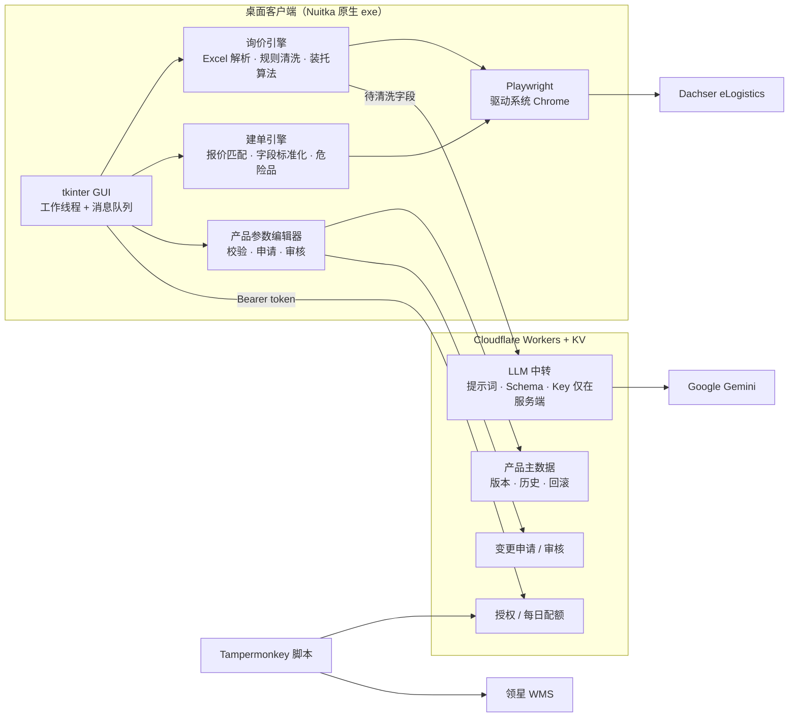
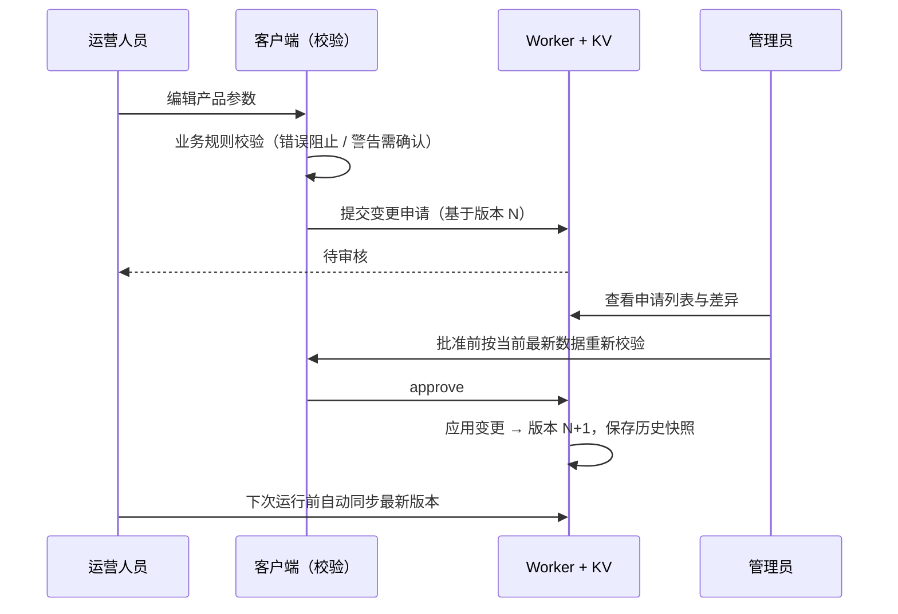

# XL FreightPilot

**Freight Quotation & Order Automation for Dachser eLogistics** · Developed by Xu Liu（刘旭）


一套面向**跨境电商海外仓物流运营**的 RPA + AI 自动化系统，帮助物流运营人员把每天在 Dachser eLogistics 门户上大量重复的手工操作——**运费询价**和**运输订单创建**——变成"选个 Excel、点开始、检查、提交"。

系统由三部分组成：

- **桌面客户端**（Python + Playwright + tkinter，Nuitka 编译为原生 Windows 程序）：解析业务 Excel、计算装托方案、驱动浏览器填写门户表单
- **云端服务**（Cloudflare Workers + KV）：授权与配额、LLM 中转、产品主数据的版本管理与审核流
- **浏览器插件脚本**（Tampermonkey）：领星 WMS 出库复核时的扫码序列号处理

> 设计原则：**机器负责填写，人负责决定。** 程序只填写、不提交，Enquiry / Save 永远由人检查后点击；AI 的输出必须先通过规则校验才会被采用。

---

## 业务背景与痛点

团队通过 Dachser 向欧洲各国发送托盘货（储能电池等，属 UN3480 危险品）。原流程中，一张订单要经过：

| 环节 | 手工操作 | 痛点 |
|---|---|---|
| 询价 | 看客户询价表 → 按产品尺寸手算装几托、每托多高多重 → 在门户逐项填国家、邮编、地址、货物行、危险品、尾板 | 客户表格格式五花八门（编号和备注混写、地址里夹着收件人和邮编）；装托计算依赖经验，容易超高超重 |
| 建单 | 从领星 ERP 导出出库单 → 按备注里的 MR 号在门户历史报价中找到对应报价 → 创建运输订单 → 抄写地址、联系人、电话 → 每个货物行添加危险品声明 → 上传危险品文件 | 一单十几个字段、多个弹窗；报价匹配靠肉眼；页面未保存就离开会导致订单被门户锁定 |
| 出库复核 | 在领星 WMS 扫描产品二维码录入序列号 | 二维码里是逗号分隔的一串序列号，批量复核框要求一行一个，需要手动改 |

XL FreightPilot 把上述流程中**可规则化的部分全部自动化**，把**需要判断的部分集中成清晰的提问**，在开始前一次性问完。

---

## 用户反馈

> "数据跑完了，准确率高达 99%" —— 物流运营同事，批量处理实际业务数据后的反馈


---

## 核心能力

### 1. 智能询价（Excel → 装托方案 → 门户询价单）
- **业务表格解析**：识别合并单元格分组的多行订单、前缀匹配表头、在格内换行的信息；选错表格类型时提示切换模式
- **AI + 规则双引擎数据清洗**：从混写的单元格中抽取订单号、备注、街道门牌号、是否需要尾板（详见下文 [AI 数据清洗](#ai-数据清洗)）
- **装托算法**：按产品主数据（箱规、每层个数、最大层数、实测整托高度/重量）计算整托 + 零托方案，合并为最多 2 个货物行，满足门户的总高度、总重量限制
- **人机协同**：所有"认不准"的情况（订单号不确定、尾板未知、AI 与规则冲突）在批量开始前集中提问；运行中可随时停止
- **自动登录与批量填写**：复用 Chrome 登录态与自动填充，逐单填写，检测到用户提交后自动进入下一单

### 2. 自动建单（ERP 出库单 → 报价匹配 → 运输订单）
- **报价匹配**：从出库单备注中提取全部 MR 号，在门户历史报价中搜索；未命中时扩大日期范围再本地筛选；排除已创建的报价。唯一匹配自动创建，多个候选交给用户选择
- **地址与联系人标准化**：街道/门牌号拆分合并、国家代码映射、邮编补回丢失的前导零、电话号码规范化（`00` → `+`）、超长字段按规则截断并保留关键信息
- **危险品声明**：为每个货物行自动打开危险品弹窗，选择 UN3480，按行填写重量、件数、包装类型；自动上传与 SKU 对应的危险品文件
- **防锁单机制**：门户编辑页会在未保存/取消前锁定订单，程序在离开页面、关闭浏览器前确认并正确释放
- **结果报告**：每单的匹配、创建、警告写入 CSV，便于复盘

### 3. 产品主数据管理与审核流
- 可视化编辑器维护各产品的装托参数，保存前做**业务规则校验**（必填项、整数、最大层数 × 箱高 + 托盘高 ≤ 限高、整托重量 ≤ 限重、实测值与计算值偏差提醒等）
- **服务器为唯一数据源**，客户端每次运行前自动同步到本地缓存，离线时退回缓存
- 普通用户提交**变更申请**（新增 / 修改 / 重命名 / 删除 / 通用默认值），由管理员审核后生效（详见下文 [审核流程](#产品参数审核流程)）

### 4. WMS 序列号助手
Tampermonkey 用户脚本，在领星 WMS 批量复核时把扫码得到的逗号分隔序列号实时转换为一行一个、去重，并通过原生 value setter + 派发 `input` 事件与 Vue 组件状态保持同步。

---

## 系统架构



---

## AI 数据清洗

客户填写的询价表是典型的"脏数据"：订单号后面跟着中文/德文备注、地址里混着收件人公司名和邮编城市、尾板一栏写着"需要尾板车辆""Nein"等各种说法。纯规则难以覆盖所有写法，纯 LLM 又存在幻觉风险，因此采用 **LLM 抽取 + 规则兜底 + 交叉校验** 的方案：

1. **规则引擎先跑一遍**：正则提取订单号、否定词优先的尾板判断、去除括号备注 / 国家 / 邮编 / `z.H.` `c/o` `Attn` 前缀后保留街道原顺序
2. **LLM 结构化抽取**：Worker 调用 Gemini，`temperature = 0`，通过 `responseSchema` 强制 JSON 结构化输出（订单号、备注、街道、尾板、疑点说明）；按 5 行一组切片、最多 10 路并发处理整张表
3. **防幻觉校验**：AI 订单号必须原样出自原单元格；AI 街道的每个词必须出自原地址且不含邮编；不满足即丢弃 AI 结果
4. **冲突交由人决定**：AI 与规则结果不一致的订单号 / 尾板，在开始前列出让用户确认；AI 指出的疑点（邮编不一致、缺门牌号）作为提示展示
5. **优雅降级**：没有授权、超出每日配额、网络或模型错误时，自动只用规则结果，流程不中断

**数据最小化与密钥安全**：只发送清洗所需的字段（不含电话、邮箱）；API Key、提示词、Schema、模型名全部只存在于服务端，客户端程序中没有任何密钥，模型可在服务端随时切换而无需重新发版。

---

## 产品参数审核流程

装托计算的准确性取决于产品主数据，因此参数修改走**带版本控制的审核流**：



- **角色权限**：管理员可直接保存与审核；其他用户只能提交、查看和撤回自己的申请；无授权或离线时编辑器只读
- **乐观并发控制**：保存基于 `base_version`，版本不一致返回 409，避免互相覆盖
- **版本历史与回滚**：每个版本保留快照，回滚即把旧版本另存为新版本，全程可追溯
- **双重校验**：提交时校验一次；审核批准时再按当时最新数据校验一次，防止基于过期数据的变更生效

---

## 工程亮点

- **应对动态 Web 应用**：门户基于 Wicket AJAX，元素 id 每次刷新都会变化——统一按 `name` 后缀和文本定位；每次交互后等待 AJAX 遮罩消失；对"隐藏 `<select>` + 自绘 div"的下拉组件实现"真实点击 → JS 事件 → DOM 同步"三级回退；搜索前给旧结果表打标记，等待其被替换，避免读到过期结果
- **CLI 与 GUI 共用一套业务代码**：所有交互通过统一的 `ask()` 抽象，命令行下是终端输入，窗口下是弹窗；自动化在工作线程运行，GUI 通过队列轮询，保证界面不卡死、弹窗失败也有兜底
- **原生编译与分发**：Nuitka 将 Python 编译为原生程序（不包含源码），自动处理非 ASCII 路径下的编译问题，打包后自动运行 `--selftest` 自检
- **授权与可控性**：每位用户独立授权码、全局与个人开关、每日 AI 配额，均在云端实时生效、无需重新发版；停用仅停止自动化，不触碰任何本地文件，行为在界面中公开说明
- **安全默认**：程序只填写不提交；涉及订单锁定、数据冲突、识别不确定的地方一律让人确认

---

## 技术栈

| 层 | 技术 |
|---|---|
| 浏览器自动化 | Playwright（Python，持久化上下文，系统 Chrome） |
| 数据处理 | openpyxl、正则、自研装托算法与字段标准化 |
| 桌面界面 | tkinter，多线程 + 消息队列 |
| AI | Google Gemini，JSON Schema 结构化输出，规则校验兜底 |
| 云端 | Cloudflare Workers（JavaScript）、Workers KV |
| 打包 | Nuitka（standalone、原生 Windows 程序） |
| 浏览器插件 | Tampermonkey 用户脚本（GM_xmlhttpRequest、Vue 输入同步） |

---

## 快速开始

### 使用打包版
1. 解压 `XL FreightPilot.zip`，**整个文件夹一起使用**
2. 电脑需安装 **Google Chrome**
3. 双击 `XL FreightPilot.exe`，点"授权码"填入授权码；首次在弹出的 Chrome 中登录 Dachser（建议让 Chrome 记住密码，之后会自动登录）
4. 选择功能 → 选择 Excel → 开始

### 从源码运行

```powershell
pip install playwright openpyxl
```

```powershell
python gui.py                                     # 窗口界面（与打包版一致）

python dachser_fill.py 询价表.xlsx --all --dry      # 询价：只预览装托方案
python dachser_fill.py 询价表.xlsx --all            # 询价：批量填写

python create_orders.py 领星导出.xlsx --dry         # 建单：只搜索匹配，不点 create
python create_orders.py 领星导出.xlsx               # 建单：搜索 + create + 填写
python create_orders.py 领星导出.xlsx --html eLogistics.html   # 建单：离线匹配预览

python pallet_plan.py 11US2000ZZD-20001 44        # 单独计算装托方案
```

### 打包

```powershell
python build.py
```

- 生成 `dist\XL FreightPilot\` 和 `dist\XL FreightPilot.zip`；打包前请关闭正在运行的 exe
- Nuitka 不支持非 ASCII 路径：项目在纯英文路径时直接在 `build/` 中编译；否则复制源码到 `D:\liuxu_build`（环境变量 `LIUXU_BUILD_DIR` 可改）并在专用虚拟环境中编译
- 打包后自动运行 `--selftest` 检查 Chrome、装托参数和授权，看到 `自检结果: OK ...` 即成功
- 新增 `.py` 模块需加入 `build.py` 的 `SOURCES`
- 产品参数在服务器上维护，修改无需重新打包

---

## 配置

| 文件 / 目录 | 说明 |
|---|---|
| `pallet_params.json` | 产品装托参数的本地缓存（不纳入 Git，打包前本机需有一份）。键 = 产品物料编码（领星 SKU）；含箱规、每层个数、最大层数、整托实测高度/重量、Dachser 包装类型，`_defaults` 为通用限制。以服务器为准，运行前自动同步（`_version` = 版本号，旧文件备份为 `.bak`） |
| `危险品文件/` | 建单时上传的危险品文件，文件名（不含扩展名）= SKU |
| `dachser_profile/` | Chrome 登录态（自动生成，不纳入 Git、不打包） |
| `xlfp_config.json` | 本机授权码（自动生成，不纳入 Git、不打包） |
| `license_check.py` | 服务器地址 `SERVER_URL`，测试时可用环境变量 `XLFP_SERVER` 覆盖 |

云端服务的部署与管理见 [`worker/README.md`](worker/README.md)。

---

## Excel 格式

### 询价表（第 1 行表头，前缀匹配）
`编号`、`国家`、`邮编`、`城市`、`地址`、`数量`、`Unit/单位`、`单个物料（长/宽/高/重量）`、`Dangerous Goods Type/危险品类型`、`产品物料`、`是否需要尾板`；可选 `运费报价(欧元)`（合并单元格 = 同一订单）、`备注…`

- 每项信息写在一个单元格内（需要多行就合并单元格或格内换行）
- `编号`：取开头连续的字母/数字/`-_/.` 作为订单号，其余视为备注；不确定时开始前询问
- `是否需要尾板`：否定词优先（不/无/否/没/no/nein/nicht/kein），再匹配肯定词；无法判断时开始前询问
- 备注只在运行记录中列出供人工处理，不自动填写
- `地址` → Street 栏：只保留街道 + 门牌号（原顺序）；残留疑似邮编或缺门牌号时提示核对

### 领星出库单
领星直接导出即可。用到的列：`Outbound Order No`、`Remark/备注`、`Recipient/收件人`、`Company`、`Country/Region`、`City`、`Post code`、`House No.`、`Address1`、`Address2`、`Province Name`、`Telephone`、`Email`、`Total Qty of SKU`、`SKU 1\nSKU`（多 SKU 时 `SKU 2\nSKU` …）

---

## 项目结构

```
gui.py              桌面界面（打包入口），工作线程运行自动化，print → 运行记录，ask() → 弹窗
app_ui.py           程序目录、ask() 交互抽象、停止标记 —— CLI 与 GUI 共用
license_check.py    授权码与云端授权检查
dachser_fill.py     询价：Excel 解析、规则清洗、Filler（Playwright 页面封装）、登录、批量填写
ai_clean.py         询价：经云端调用 LLM 清洗，与规则结果合并校验，失败时退回规则
pallet_plan.py      装托算法，参数文件读写与业务校验
params_editor.py    产品参数编辑器（提交申请 / 审核 / 历史版本）
params_sync.py      产品参数同步、申请与审核接口
create_orders.py    建单：报价搜索匹配、创建、填写运输订单、危险品弹窗、文件上传、防锁单
match_orders.py     领星表读取、地址比对、国家映射
fetch_dachser.py    match_orders 在线模式的抓取辅助
worker/             Cloudflare Worker：授权、配额、LLM 中转、产品主数据与审核流
build.py            Nuitka 打包
xlfp-wms-sn.user.js 领星 WMS 序列号助手（Tampermonkey）
```

---

## 常见问题

- **"The order is being processed by someone else"**：建单编辑页未 Save/Cancel 就离开会被门户锁单。程序离开前会确认；已被锁的单需等门户会话过期
- **杀毒软件 / "已保护你的电脑"**：未签名的 exe 可能被拦截，点"更多信息 → 仍要运行"或加白名单
- **弹窗找不到**：看任务栏中的 "XL FreightPilot - 请确认"，或点一下主窗口，弹窗会回到最前

---

© 2026 Xu Liu（刘旭）. All rights reserved. · xuliu00925@gmail.com
